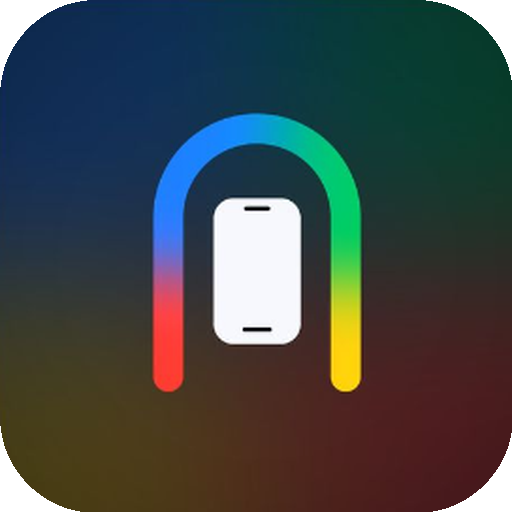

<div align="center">
  
  <h1>Antigravity Remote</h1>
  <p><strong>Secure mobile &amp; web remote control for Google Antigravity on your PC</strong></p>

  <p>
    
    
    
    
  </p>

  <p>
    <a href="GUIDE_EN.md">Quick Guide (English)</a> ·
    <a href="GUIDE_AR.md">الدليل السريع (العربية)</a> ·
    <a href="docs/GUIDE.en.md">Full Reference (EN)</a> ·
    <a href="docs/GUIDE.ar.md">الدليل الكامل (AR)</a> ·
    <a href="https://antigravity-remote-8fi.pages.dev/">Web Client</a> ·
    <a href="https://github.com/Tareq612345/antigravity-remote/releases">Releases</a>
  </p>
</div>

---

## Overview

**Antigravity Remote** lets you chat with your local **Google Antigravity** (`agy` CLI) session, browse and transfer workspace files, switch models and thinking effort, and monitor local IDE transcripts from your phone or any browser — without screen sharing or opening router ports.

> [!NOTE]
> This is an **unofficial**, community-built project and is not affiliated with or endorsed by Google.

---

## Quick Start (Simple & Fast)

1. **Prerequisite:** Make sure **`agy` CLI** is installed and signed in on your Windows PC (`~/.gemini/bin/agy.exe`). If `agy` is not installed yet, the desktop app includes a built-in one-click installer button. The app launches `agy` for each message, so the CLI must work on its own — the Antigravity IDE does not need to be open.
2. **Download & Run:** Download **`AntigravityRemote.exe`** ([release `0.1`](https://github.com/Tareq612345/antigravity-remote/releases/tag/0.1), 32.9 MB) and double-click it. Its SHA256 is listed under [Latest Release Checksum](#latest-release-checksum-01).
3. **Link Google Account:** Click **Sign in with Google** in the desktop window, then click **Confirm & Link This PC**.
4. **Open on Mobile:** Visit **[https://antigravity-remote-8fi.pages.dev/](https://antigravity-remote-8fi.pages.dev/)** from your phone and sign in with the **same Google account**.

For full step-by-step instructions, see [`GUIDE_EN.md`](GUIDE_EN.md) / [`docs/GUIDE.en.md`](docs/GUIDE.en.md) or [`GUIDE_AR.md`](GUIDE_AR.md) / [`docs/GUIDE.ar.md`](docs/GUIDE.ar.md).

---

## Key Features

- **Direct `agy` CLI Integration:** Uses your existing Antigravity account, subscription models, and tools in the background.
- **Model, Thinking Effort & Usage Viewer:** Switch between available models (`Gemini`, `Claude`, `GPT-OSS`), adjust thinking effort (`low`, `medium`, `high`, `xhigh`), and inspect session token usage.
- **Live IDE Transcript Mirror:** View and follow your local Antigravity IDE conversations in real time.
- **Message Queue & Cancel:** Queue follow-up prompts while the agent is still working, or stop a running turn anytime.
- **Workspace File Explorer & Safe Uploads:** Browse project files, download files to mobile, and upload images, audio, or documents into `_uploads/`.
- **Active & Pinned Files Bar:** Automatically tracks files touched by the agent and lets you pin frequently used files for one-tap preview.
- **Slash Commands & Skills Menu (`/`):** Trigger built-in slash commands and local Antigravity skills directly from the chat input.
- **Built-in `agy` CLI Installer & Update Checks:** Install `agy` CLI from inside the desktop app if missing, and get notified automatically when a new GitHub release is available.
- **Sliding Windows Sleep Manager:** Keeps your PC awake (while allowing the display to turn off) for 7 hours and automatically resets the timer on every interaction.
- **Lightweight Desktop App + System Tray:** Built with `pywebview` (Edge WebView2) and `pystray` for minimal RAM and CPU usage.
- **Zero-Config Remote Access:** Automatically spawns a SHA256-verified **Cloudflare Tunnel** and pairs your PC to your Google account via **Supabase** with Row Level Security (RLS).

---

## Run from Source

```bash
git clone https://github.com/Tareq612345/antigravity-remote.git
cd antigravity-remote

python -m venv .venv
.venv\Scripts\activate
pip install -r requirements.txt

python desktop_app.py
```

Or run the headless server directly:
```bash
uvicorn server:app --host 127.0.0.1 --port 8765 --no-access-log
```

---

## Building the Executable

```bash
pip install pyinstaller
pyinstaller --noconfirm --onefile --noconsole --name AntigravityRemote --icon "static\app.ico" --add-data "static;static" --exclude-module google.antigravity --exclude-module google.genai --exclude-module mcp --exclude-module tkinter --exclude-module unittest --exclude-module pydoc desktop_app.py
```

### Latest Release Checksum (`0.1`)
- `AntigravityRemote.exe` (`SHA256`):
  ```text
  D387F9147465E3F53566511A553F5C1C3670B07CF7A1FF137D7678BDEBF4EF55
  ```

---

## Testing & Security

```bash
python -m unittest discover -s tests -v
pip-audit -r requirements.txt
```

See [`SECURITY.md`](SECURITY.md) for authentication details, file permission hardening, and vulnerability reporting.
